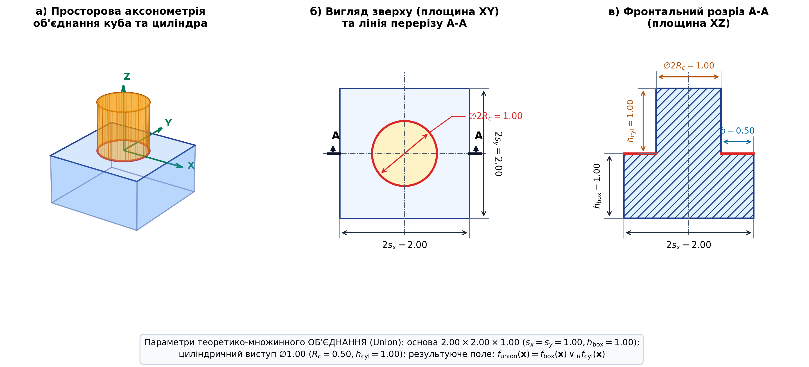

# 2. Materials and Methods

**2.1. Критерії якості сітки.** Для оцінювання якості згенерованих полігональних поверхонь $\mathcal{M} = (\mathcal{V}, \mathcal{F})$ та визначення
їхньої придатності для препроцесингу МСЕ сформовано комплексну систему
критеріїв [[4](06-references.md#ref-4), [7](06-references.md#ref-7), [22](06-references.md#ref-22)], що охоплює чотири
групи взаємопов'язаних показників: топологію сітки, форму трикутників, геометричну
точність апроксимації та обчислювальну складність.

Первинною вимогою є топологічна допустимість поверхні, невиконання якої унеможливлює побудову конформної
об'ємної сітки тетраедрів або гексаедрів у генераторах TetGen та
Gmsh [[4](06-references.md#ref-4), [17](06-references.md#ref-17)].
Вона передбачає забезпечення герметичності (watertight), тобто замкненості границі $\partial \mathcal{M} = \emptyset$ за
повної
відсутності відкритих ребер [[18](06-references.md#ref-18)], а також відсутність нерізноманітних дефектів
($N_{\mathrm{non\_man}} = 0$) — ребер із кількістю інцидентних граней $\|\mathcal{F}(e)\| \neq 2$, самоперетинів і
сингулярних
вузлів розгалуження [[19](06-references.md#ref-19), [24](06-references.md#ref-24)], що порушують конформність
дискретизації
та призводять до розриву базисних функцій МСЕ.

Для оцінювання форми трикутників для кожної грані $T \in \mathcal{F}$ доцільно обчислювати такі
локальні характеристики:
- **внутрішні кути трикутника** $\theta_i(T)$ ($i = 1, 2, 3$), зокрема найменший кут
  $\theta_{\min}(T) = \min(\theta_1, \theta_2, \theta_3)$ [[4](06-references.md#ref-4), [7](06-references.md#ref-7), [22](06-references.md#ref-22)];
- **коефіцієнт форми (регулярності)**:
  $$Q(T) = \frac{4\sqrt{3} \, S(T)}{l_1^2 + l_2^2 + l_3^2} \in [0, 1],$$
  де $S(T)$ — площа трикутника, $l_1, l_2, l_3$ — довжини його сторін [[21](06-references.md#ref-21)];
- **співвідношення сторін**:
  $$\mathrm{AR}(T) = \frac{l_{\max}}{2\sqrt{3} r_{\mathrm{in}}} \ge 1,$$
  де $l_{\max}$ — найдовша сторона, $r_{\mathrm{in}}$ — радіус вписаного кола [[4](06-references.md#ref-4), [7](06-references.md#ref-7)].

Для інтегрального оцінювання якості поверхні за цими величинами визначаються екстремальні значення (зокрема
мінімальний кут сітки $\alpha_{\min} = \min_{T \in \mathcal{F}} \theta_{\min}(T)$), статистичні розподіли (гістограми) та
відсоткова частка елементів, що виходять за межі допустимих діапазонів (передусім частка вироджених трикутників
$S_{<10^\circ}$ із кутом $\theta_{\min} < 10^\circ$ [[4](06-references.md#ref-4), [24](06-references.md#ref-24)], а також
частка елементів із $\mathrm{AR} > 4$).

Для оцінювання геометричної точності апроксимації неявного тіла доцільно обчислювати:
- **середню нев'язку поверхні ($E_{\mathrm{surf}}$)**:
  $$E_{\mathrm{surf}} = \frac{1}{M \cdot \Delta x} \sum_{k=1}^M |f(\mathbf{p}_k)|,$$
  де $\mathbf{p}_k$ ($k = 1, \dots, M$) — вибірка точок, згенерованих на поверхні методом
  Монте-Карло, $\Delta x$ — крок воксельної сітки [[4](06-references.md#ref-4), [14](06-references.md#ref-14), [24](06-references.md#ref-24)];
- **точність відтворення гострих ребер ($\mathrm{EF}_1$)** та **похибку локалізації ліній зламу ($E_{\mathrm{crease}}$)**:
  $$\mathrm{EF}_1 = \frac{2 P_{\mathrm{edge}} R_{\mathrm{edge}}}{P_{\mathrm{edge}} + R_{\mathrm{edge}}},$$
  де $P_{\mathrm{edge}}$ і $R_{\mathrm{edge}}$ — відповідно точність (precision) та повнота (recall) виявлення ребер із
  двогранним кутом $< 150^\circ$ відносно теоретичної геометрії CSG-моделі [[4](06-references.md#ref-4), [19](06-references.md#ref-19), [21](06-references.md#ref-21), [24](06-references.md#ref-24)],
  а $E_{\mathrm{crease}}$ — середня відстань від знайдених гострих ребер сітки до аналітичних ліній зламів;
- **кутове відхилення поля нормалей ($\theta_{\mathrm{norm}}$)**:
  $$\theta_{\mathrm{norm}} = \arccos(\mathbf{n}_{\mathrm{face}} \cdot \mathbf{n}_{\mathrm{exact}}),$$
  де $\mathbf{n}_{\mathrm{exact}} = \nabla f / \|\nabla f\|$ — аналітична нормаль у центроїді
  грані [[4](06-references.md#ref-4), [19](06-references.md#ref-19), [24](06-references.md#ref-24)]. Для оцінювання орієнтації поверхні визначаються середнє значення, статистичний розподіл, а також відсоткова частка граней із кутовою похибкою понад поріг $5^\circ$ ($\% \mathrm{IN}_{>5^\circ}$ — частка неточних нормалей, inaccurate normals);
- **відносну похибку об'єму ($\delta V$)**:
  $$\delta V = \frac{|V(\mathcal{M}) - V_{\mathrm{exact}}|}{V_{\mathrm{exact}}},$$
  де інтегральний об'єм $V(\mathcal{M})$ обчислюється за теоремою Остроградського–Гаусса [[16](06-references.md#ref-16)].

Обчислювальна ефективність екстракції оцінюється часом генерації сітки $t_{\mathrm{gen}}$ (у секундах) [[4](06-references.md#ref-4), [18](06-references.md#ref-18), [24](06-references.md#ref-24)]
та розмірністю отриманої поверхневої моделі — кількістю вершин $|\mathcal{V}|$ і граней $|\mathcal{F}|$ [[4](06-references.md#ref-4), [24](06-references.md#ref-24)],
що визначає просторову роздільну здатність границі для подальшої об'ємної дискретизації у розв'язувачах МСЕ.

**2.2. Математичний апарат систем R-функцій**.  Для аналітичного опису складних геометричних форм використовуються системи
R-функцій [[1](06-references.md#ref-1), [10](06-references.md#ref-10), [11](06-references.md#ref-11)]. Базові
теоретико-множинні операції конструюються для пари функцій-аргументів $f_1(\mathbf{x})$ та $f_2(\mathbf{x})$:

1. **Класична система $R_0$ Рвачова**:
   $$\mathcal{R}_\wedge^0 (f_1, f_2) \equiv f_1 \wedge_{R_0} f_2 = f_1 + f_2 - \sqrt{f_1^2 + f_2^2},$$
   $$\mathcal{R}_\vee^0 (f_1, f_2) \equiv f_1 \vee_{R_0} f_2 = f_1 + f_2 + \sqrt{f_1^2 + f_2^2},$$
   $$\mathcal{R}_\neg (f_1) \equiv \neg_{R} f_1 = -f_1.$$
   Різниця геометричних областей реалізується як $f_1 \setminus_R f_2 = f_1 \wedge_{R_0} (-f_2)$.

2. **Система $R_\alpha$ Рвачова** ($\alpha \in (-1, 1]$):
   $$f_1 \wedge_{R_\alpha} f_2 = \frac{1}{1 + \alpha} \left( f_1 + f_2 - \sqrt{f_1^2 + f_2^2 - 2\alpha f_1 f_2} \right) (f_1^2 + f_2^2)^{\alpha / 2}.$$
   У дослідженні детально розглянуто випадки $\alpha = -0.5$ та $\alpha = 0.5$.

3. **Система $R_p$**:
   $$f_1 \wedge_{R_p} f_2 = f_1 + f_2 - (f_1^p + f_2^p)^{1/p}, \quad p \in \{4, 8\}.$$

4. **Нормалізована система $R_{m0}$ першого порядку**:
   $$f_1 \wedge_{R_{m0}} f_2 = \frac{f_1 + f_2 - \sqrt{f_1^2 + f_2^2}}{\sqrt{1 + \left(\frac{f_1 - f_2}{\sqrt{f_1^2 + f_2^2}}\right)^2}}.$$

5. **Негладка система $\min / \max$** (традиційна CSG для SDF):
   $$f_1 \wedge_{\min} f_2 = \min(f_1, f_2), \quad f_1 \vee_{\max} f_2 = \max(f_1, f_2).$$

**2.3. Тестова геометрична модель**. Базовим об'єктом дослідження є аналітична модель на основі **теоретико-множинного об'єднання кубічної основи та циліндра ($\mathcal{M}_{\mathrm{union}}$)**, що відтворює характерну конфігурацію машинобудівних деталей із взаємно ортогональними плоскими гранями, циліндричним виступом та внутрішніми (вхідними) лініями зламів (рис. 1).

Модель конструюється як теоретико-множинна CSG-композиція паралелепіпедної основи та виступаючого циліндра вздовж осі $Z$:
$$f_{\mathrm{union}}(\mathbf{x}) = f_{\mathrm{box}}(\mathbf{x}) \vee_{R} f_{\mathrm{cyl}}(\mathbf{x}),$$
де основа задається предикатом $f_{\mathrm{box}}(\mathbf{x}) = \min(s_x - |x|, s_y - |y|, z_{\mathrm{junction}} - z, z - z_{\mathrm{base\_min}})$ із напіврозмірами $s_x = s_y = 1.00$ (габарити в плані $2.00 \times 2.00$) та висотою $h_{\mathrm{box}} = 1.00$ ($z \in [-1.00, 0.00]$), а виступаючий циліндр — рівнянням $f_{\mathrm{cyl}}(\mathbf{x}) = \min(R_c^2 - (x^2 + y^2), z_{\mathrm{cyl\_max}} - z, z - z_{\mathrm{junction}})$ із радіусом $R_c = 0.50$ (діаметр виступу $\varnothing 1.00$) та висотою $h_{\mathrm{cyl}} = 1.00$ ($z \in [0.00, 1.00]$). Розрахункова область дискретизації становить симетричний куб $\Omega = [-1.05, 1.05]^3$. Теоретико-множинне об'єднання $\vee_R$ утворює монолітне ступінчасте тіло з плоскими взаємно ортогональними гранями, круговим торцем циліндра ($z = 1.00$), горизонтальним опорним буртиком завширшки $b = 0.50$ ($z = 0.00$) та внутрішньою (вхідною) круговою лінією зламу під кутом $90^\circ$ на лінії спряження основи та виступу, яка слугує строгим еталоном для оцінювання геометричної точності екстракції.

  
*Рис. 1. Параметричне креслення тестової геометричної моделі теоретико-множинного об'єднання куба та циліндра ($\mathcal{M}_{\mathrm{union}}$): а — просторова аксонометрія з координатним базисом; б — вигляд зверху (площина XY) та лінія перерізу А–А; в — фронтальний розріз А–А (площина XZ) із суцільним штрихуванням монолітного перерізу та позначенням лінії вхідного зламу*

**2.6. Програмне та апаратне середовище досліджень**. Обчислювальний стенд реалізовано мовою Python 3.14 / 3.12 з використанням бібліотек наукових розрахунків NumPy 2.x,
SciPy, Trimesh (геометричні перевірки, вибірка $M = 5000$ контрольних точок для оцінки нев'язки поверхні, трасування нормалей, розрахунок площ і об'ємів), PyTorch 2.x (диференційовна
оптимізація параметрів FlexiCubes на базі тензорних операцій), scikit-image (канонічна реалізація Marching Cubes
Lewiner/Lorensen).

Експерименти виконувалися на обчислювальній станції під керуванням 64-розрядної операційної системи Windows, оснащеній
багатоядерним процесором архітектури x86-64 та графічним прискорювачем із підтримкою обчислень CUDA.
