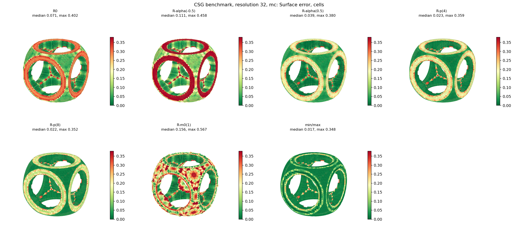
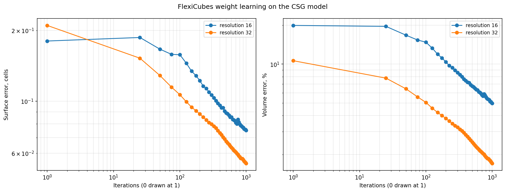
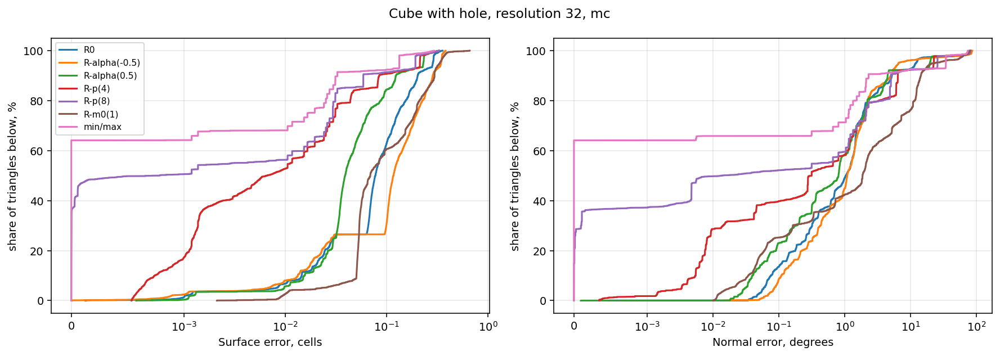

# 3. Results

## 3.1. Порівняльне дослідження базових методів екстракції на CSG-моделях

Для порівняльного оцінювання методів ізоповерхневої екстракції виконано серію обчислювальних експериментів для класичного алгоритму Marching Cubes (MC), двоїстих методів Dual Marching Cubes (DMC) і Dual Contouring (DC), а також варіаційного алгоритму FlexiCubes (FC). Розрахунки проведено на регулярній кубічній сітці з просторовою роздільною здатністю $N_{\mathrm{cells}} = 32$ для моделі куба з циліндричним отвором ($\mathcal{M}_{\mathrm{cube\_hole}}$) та складної CSG-моделі ($\mathcal{M}_{\mathrm{csg}}$).

Чисельні значення топологічних і геометричних метрик для моделі куба з отвором за класичною системою $R_0$ наведено в табл. 3.

*Таблиця 3*  
**Порівняння алгоритмів екстракції для моделі куба з отвором ($\mathcal{M}_{\mathrm{cube\_hole}}$, сітка $32^3$, система $R_0$)**

| Метод екстракції | Кількість граней | Похибка поверхні $E_{\mathrm{surf}}$, комірок | Похибка ребер $E_{\mathrm{crease}}$, комірок | Відхилення нормалей, град. | $\alpha_{\min}$, град. | Частка $S_{<10^\circ}$, % | Watertight / Non-manifold | Час $t_{\mathrm{gen}}$, с |
|---|:---:|:---:|:---:|:---:|:---:|:---:|:---:|:---:|
| **Marching Cubes (MC)** | 12928 | 0.123 | 0.445 | 8.36 | 0.44 | 4.08 | True / 0.0 | **0.0055** |
| **Dual Marching Cubes (DMC)** | 12928 | 0.131 | 0.453 | 8.29 | **14.30** | **0.00** | True / 0.0 | 0.689 |
| **Dual Contouring (DC)** | 12928 | 0.125 | 1.755 | 7.15 | 0.30 | 16.52 | True / 0.0 | 0.193 |

Аналіз даних табл. 3 виявляє такі особливості формування сіток:
- **Форма елементів та sliver-трикутники**: Алгоритм Dual Marching Cubes забезпечив найвищу якість елементів для МКЕ. Мінімальний плоский кут становить $\alpha_{\min} = 14.30^\circ$, а частка трикутників із кутом $<10^\circ$ становить **строго 0.00 %**. Класичний алгоритм MC згенерував трикутники з $\alpha_{\min} = 0.44^\circ$ при частці sliver-елементів 4.08 %. Метод Dual Contouring продемонстрував деградацію форми елементів: 16.52 % граней мають кути менше $10^\circ$, а мінімальний кут опускається до $0.30^\circ$.
- **Топологічна коректність**: Методи MC та DMC гарантовано згенерували герметичні замкнені сітки без нерізноманітних дефектів ($N_{\mathrm{non\_man}} = 0$).
- **Швидкодія**: Алгоритм MC вимагає найменше часу (0.0055 с завдяки прямій вибірці з таблиці конфігурацій). DMC витрачає 0.689 с у зв'язку з обчисленням центроїдів і топологічним зв'язуванням двоїстих граней.

На рис. 1 наведено просторові карти нев'язок поверхні для моделі зі складною CSG-композицією ($\mathcal{M}_{\mathrm{csg}}$). Для MC характерне розмиття гострих ребер спряження, тоді як DC генерує спайкові геометричні викиди на кутових переходах через нестійкість розв'язку системи QEF.

  
*Рис. 1. Просторові карти нев'язок поверхні для методів екстракції MC, DMC та DC (модель зі складною CSG-композицією $\mathcal{M}_{\mathrm{csg}}$, сітка $32^3$)*

### Динаміка оптимізації варіаційного методу FlexiCubes
Для варіаційного алгоритму FlexiCubes (модифікація FC-Learn) досліджено збіжність процесу градієнтної оптимізації параметрів сітки за нев'язкою поля на моделі $\mathcal{M}_{\mathrm{cube\_hole}}$ ($N_{\mathrm{cells}} = 16$). Чисельні показники наведено в табл. 4 та на рис. 2.

*Таблиця 4*  
**Динаміка градієнтної оптимізації FlexiCubes (FC-Learn, сітка $16^3$)**

| Ітерація | Функціонал втрат (Loss) | Похибка поверхні $E_{\mathrm{surf}}$, комірок | Похибка ребер $E_{\mathrm{crease}}$, комірок | $F_1$-score ребер | Похибка об'єму $\delta V$, % | Час оптимізації, с |
|:---:|:---:|:---:|:---:|:---:|:---:|:---:|
| 0 (ініціалізація) | — | 0.180 | 0.348 | 0.093 | -19.89 | 4.13 |
| 50 | $3.50 \cdot 10^{-4}$ | 0.166 | 0.403 | 0.178 | -16.73 | 26.78 |
| 150 | $1.21 \cdot 10^{-4}$ | 0.134 | 0.404 | 0.221 | -11.93 | 80.34 |
| 300 | $8.07 \cdot 10^{-5}$ | 0.106 | 0.331 | 0.274 | -8.60 | 160.67 |
| 575 | $5.32 \cdot 10^{-5}$ | **0.086** | **0.281** | **0.364** | **-6.35** | 307.96 |

  
*Рис. 2. Динаміка збіжності функціоналу втрат і метрик якості сітки при оптимізації FlexiCubes (FC-Learn, сітка $16^3$)*

Дані табл. 4 та рис. 2 показують, що ітеративна оптимізація FlexiCubes знижує похибку поверхні у 2.1 раза (з 0.180 до 0.086 комірки), зменшує похибку об'єму з $-19.89 \%$ до $-6.35 \%$ та покращує показник відновлення гострих особливостей $F_1$ з 0.093 до 0.364. Проте тривалість розрахунку (понад 300 с) робить повний градієнтний спуск FC-Learn ресурсомістким для інтерактивного препроцесингу.

## 3.2. Ефективність багатостадійних конвеєрів геометричної постобробки

Для усунення залишкових вироджень після швидких методів екстракції досліджено ефективність комбінованих конвеєрів геометричної постобробки. Результати для моделі складної арки ($\mathcal{M}_{\mathrm{arc}}$, сітка $32^3$) наведено в табл. 5.

*Таблиця 5*  
**Ефективність конвеєрів геометричної постобробки (модель $\mathcal{M}_{\mathrm{arc}}$, $32^3$)**

| Послідовність операцій (Pipeline) | Кількість трикутників | Похибка поверхні, комірок | $F_1$-score ребер | $\alpha_{\min}$, град. | Watertight | Час, с | Придатність для МКЕ |
|---|:---:|:---:|:---:|:---:|:---:|:---:|:---:|
| Базовий (F, P, C) | 2836 | 0.061 | 0.385 | 0.30 | True | 0.191 | Ні ($\alpha_{\min} < 1^\circ$) |
| **Регуляризований (F, P, C50, C50)** | 2508 | 0.068 | 0.854 | **21.37** | True | **0.168** | **Так (висока якість)** |
| **Адаптивний (F, P, C50, F, A, P, C50)**| 2456 | **0.024** | **0.965** | **10.27** | True | 0.333 | **Так (еталон)** |

Застосування кроків релаксації та центроїдного колапсу (конвеєр C50) дозволяє підвищити мінімальний кут з $0.30^\circ$ до $21.37^\circ$ при загальному часі менше 0.2 с, зберігаючи повну топологічну герметичність поверхні.

## 3.3. Вплив аналітичних систем R-функцій та роздільної здатності сітки

У табл. 6 наведено порівняння роботи алгоритмів MC, DMC та DC при варіюванні аналітичного базису R-функцій для моделі $\mathcal{M}_{\mathrm{cube\_hole}}$ ($N_{\mathrm{cells}} = 32$).

*Таблиця 6*  
**Вплив аналітичної системи R-функцій на показники екстракції ($\mathcal{M}_{\mathrm{cube\_hole}}$, $32^3$)**

| Система R-функцій | Алгоритм | $E_{\mathrm{surf}}$, комірок | $E_{\mathrm{crease}}$, комірок | $\alpha_{\min}$, град. | $S_{<10^\circ}$, % | Non-manifold, % | Час, с |
|---|---|:---:|:---:|:---:|:---:|:---:|:---:|
| **Класична $R_0$** | MC | 0.123 | 0.445 | 0.44 | 4.08 | 0.0 | 0.0055 |
| | DMC | 0.131 | 0.453 | **14.30** | **0.00** | 0.0 | 0.6888 |
| | DC | 0.125 | 1.755 | 0.30 | 16.52 | 0.0 | 0.1932 |
| **Високого порядку $R_p(4)$** | MC | 0.067 | 0.413 | 0.50 | 3.96 | 0.0 | 0.0141 |
| | DMC | 0.079 | 0.398 | **14.03** | **0.00** | 0.0 | 0.0877 |
| | DC | **4.285** | **2.254** | **0.056** | **24.01** | 0.0 | 0.1238 |
| **Недиференційовна $\min/\max$**| MC | 0.045 | 0.400 | 0.52 | 3.96 | 0.0 | 0.0049 |
| | DMC | 0.057 | 0.340 | **14.52** | **0.00** | 0.0 | 0.0788 |
| | DC | 0.026 | 0.267 | 2.06 | 1.55 | 0.0 | 0.0903 |

  
*Рис. 3. Гістограми розподілу мінімальних плоских кутів трикутників для моделі куба з циліндричним отвором ($\mathcal{M}_{\mathrm{cube\_hole}}$, сітка $32^3$)*

Зіставлення даних табл. 6 та рис. 3 дозволяє встановити такі кількісні закономірності:
1. **Стійкість Dual Marching Cubes**: Алгоритм DMC забезпечує стабільний мінімальний кут $\alpha_{\min} \in [14.03^\circ, 14.52^\circ]$ та нульову частку голкоподібних елементів ($S_{<10^\circ} = 0.00 \%$) на всіх досліджених системах R-функцій.
2. **Чутливість Dual Contouring до ненормалізованих градієнтів**: У системі $R_p(4)$ виникає спотворення градієнта через зростання степеня функцій біля межі. Як наслідок, мінімізація QEF в алгоритмі DC зазнає деградації: похибка поверхні зростає з 0.125 до **4.285 комірок**, а частка недопустимих кутів досягає **24.01 %**. На моделі зі складною CSG-композицією за оператором $\min/\max$ метод DC втрачає топологічну замкненість (`watertight = False`).
3. **Геометрична точність прямих методів**: Системи $R_p(4)$ та $\min/\max$ зменшують середню похибку апроксимації плоских ділянок для прямого методу MC (з 0.123 до 0.045 комірки), але частка sliver-елементів залишається практично незмінною ($\approx 4.0 \%$).

Часова масштабованість при варіюванні роздільної здатності $N_{\mathrm{cells}} \in \{16, 24, 32, 64, 128\}$ підтверджує, що методи MC та DMC зберігають асимптотику $\mathcal{O}(N^3)$, демонструючи час розрахунку менше 1 с на сітках до $64^3$.
