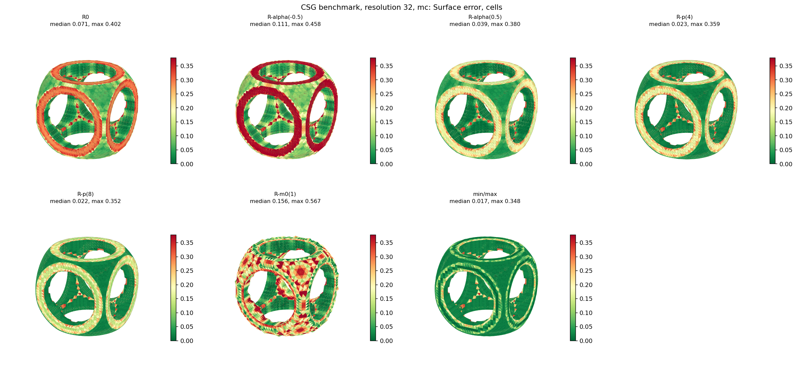
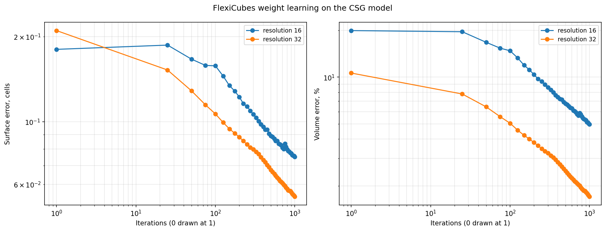
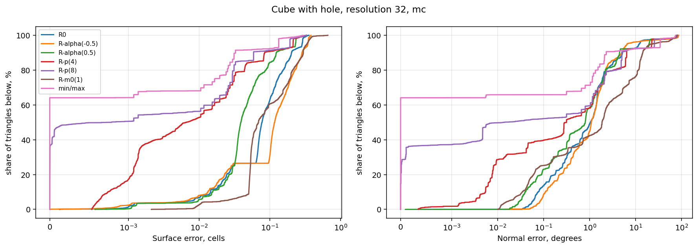

<!-- Профіль journal (7-розділова схема). Вимоги: article_rules/Зразок_рукопису.docx
     Розділ 5: Результати досліджень.
     Структура строго відповідає задачам розділу 3:
     Підрозділ 5.1 -> Задача 1 (Система критеріїв якості сітки для МКЕ);
     Підрозділ 5.2 -> Задача 2 (Порівняльне дослідження базових методів MC, DMC, DC, FC);
     Підрозділ 5.3 -> Задача 3 (Вплив систем R-функцій та роздільної здатності). -->

# 5. Результати досліджень

## 5.1. Формування та аналіз комплексної системи критеріїв якості сітки для препроцесингу МКЕ

У результаті вирішення першої задачі дослідження сформовано багаторівневу систему критеріїв оцінки полігональних поверхонь, адаптовану до вимог чисельного моделювання фізичних полів методом скінченних елементів. 

На відміну від завдань візуалізації, де якість сітки традиційно оцінюється лише за геометричною похибкою Гаусдорфа та загальною кількістю трикутників, у задачах МКЕ препроцесингу визначальну роль відіграє регулярність форми елементів та їхня топологічна конформність. Розроблена система класифікує метрики за чотирма функціональними рівнями:

1. **Топологічний фільтр припустимості (Hard Constraints)**:
   - Перевірка замкненості (`watertight`): порушення герметичності робить неможливою подальшу автоматичну об'ємну дискретизацію тетраедральними сіткогенераторами (типу Delaunay або Advancing Front).
   - Відсутність нерізноманітних сингулярностей ($N_{\mathrm{non\_man}} = 0$): виявлення ребер, що інцидентні трьом і більше трикутникам, або розщеплених вершин.
2. **МКЕ-критерії форми елементів (Solvability Metrics)**:
   - Мінімальний плоский кут трикутників $\alpha_{\min}$: безпосередньо корелює з діагональним переважанням та обумовленістю локальних матриць жорсткості.
   - Частка елементів із кутом $\alpha < 10^\circ$ ($S_{<10^\circ}$): частка потенційних sliver-елементів (вироджених елементів), наявність яких вимагає примусового топологічного колапсу ребер або призводить до чисельної нестабільності розв'язувача.
   - Коефіцієнт ізотропності $Q$: відношення площі до суми квадратів ребер.
3. **Геометрична апроксимаційна точність (Fidelity Metrics)**:
   - Середнє абсолютне відхилення від нульового рівня $E_{\mathrm{surf}}$, нормалізоване на просторовий крок ґратки $\Delta x$.
   - Інтегральна кутова похибка орієнтації нормалей $\theta_{\mathrm{err}}$ (відхилення між нормаллю до грані та аналітичним вектором градієнта поля).
   - Похибка локалізації ліній зламу (Crease Error) та $F_1$-score збереження гострих особливостей.
   - Відносна похибка апроксимації об'єму тіла $\delta V$.
4. **Обчислювальна ефективність та ресурси (Resource Metrics)**:
   - Час виконання екстракції $t_{\mathrm{gen}}$, чутливість до кроку ґратки $O(N^3)$, пікове використання пам'яті процесу.

## 5.2. Порівняльне дослідження методів екстракції на моделях складної CSG-геометрії

Відповідно до другої задачі виконано серію обчислювальних експериментів для алгоритмів Marching Cubes (MC), Dual Marching Cubes (DMC) та Dual Contouring (DC), а також варіаційного алгоритму FlexiCubes (FC). Розрахунки проведено на регулярній ґратці просторової роздільної здатності $N_{\mathrm{cells}} = 32$ для моделі куба з отвором ($\mathcal{M}_{\mathrm{cube\_hole}}$) та складної CSG-моделі ($\mathcal{M}_{\mathrm{csg}}$).

Чисельні результати для моделі куба з циліндричним отвором за класичною системою $R_0$ наведено в табл. 3.

*Таблиця 3*  
**Порівняння алгоритмів екстракції для моделі куба з отвором ($\mathcal{M}_{\mathrm{cube\_hole}}$, ґратка $32^3$, система $R_0$)**

| Метод екстракції | Кількість граней | Похибка поверхні $E_{\mathrm{surf}}$, комірок | Похибка ребер $E_{\mathrm{crease}}$, комірок | Відхилення нормалей, град. | $\alpha_{\min}$, град. | Частка $S_{<10^\circ}$, % | Watertight / Non-manifold | Час $t_{\mathrm{gen}}$, с |
|---|:---:|:---:|:---:|:---:|:---:|:---:|:---:|:---:|
| **Marching Cubes (MC)** | 12928 | 0.123 | 0.445 | 8.36 | 0.44 | 4.08 | True / 0.0 | **0.0055** |
| **Dual Marching Cubes (DMC)** | 12928 | 0.131 | 0.453 | 8.29 | **14.30** | **0.00** | True / 0.0 | 0.689 |
| **Dual Contouring (DC)** | 12928 | 0.125 | 1.755 | 7.15 | 0.30 | 16.52 | True / 0.0 | 0.193 |

Аналіз даних табл. 3 виявляє фундаментальні відмінності між класами алгоритмів:

- **Форма елементів**: Алгоритм Dual Marching Cubes продемонстрував абсолютну перевагу за критерієм якості елементів для МКЕ. Мінімальний кут становить $\alpha_{\min} = 14.30^\circ$, а частка трикутників з кутом $<10^\circ$ дорівнює **строго 0.00 %**. Навпаки, класичний MC генерує трикутники з $\alpha_{\min} = 0.44^\circ$ (4.08 % sliver-елементів). Метод Dual Contouring показав катастрофічне засмічення сітки виродженими елементами: 16.52 % граней мають кути менше $10^\circ$, а мінімальний кут опускається до $0.30^\circ$.
- **Топологічна надійність**: І MC, і DMC гарантовано сформували багатовидові замкнені сітки ($N_{\mathrm{non\_man}} = 0$).
- **Швидкодія**: Алгоритм MC залишається найшвидшим (0.0055 с завдяки прямій вибірці з таблиці конфігурацій). DMC вимагає 0.689 с у зв'язку з необхідністю обчислення центроїдів і топологічного зв'язування подвійних граней.

На рис. 1 представлено просторові карти нев'язок поверхні для моделі зі складною CSG-композицією ($\mathcal{M}_{\mathrm{csg}}$). Для MC характерне розмиття гострих ліній спряження, тоді як DC генерує спайкові геометричні викиди на кутових сингулярностях.

  
*Рис. 1. Просторові карти нев'язок поверхні для методів екстракції MC, DMC та DC (модель зі складною CSG-композицією $\mathcal{M}_{\mathrm{csg}}$, ґратка $32^3$)*

### Дослідження диференційовної оптимізації FlexiCubes
Для варіаційного алгоритму FlexiCubes (варіант FC-Learn) досліджено збіжність процесу градієнтної оптимізації параметрів решітки за нев'язкою поля на моделі $\mathcal{M}_{\mathrm{cube\_hole}}$ ($N_{\mathrm{cells}} = 16$). Результати наведено в табл. 4 та на рис. 2.

*Таблиця 4*  
**Динаміка градієнтної оптимізації FlexiCubes (FC-Learn, ґратка $16^3$)**

| Ітерація | Функціонал втрат (Loss) | Похибка поверхні $E_{\mathrm{surf}}$, комірок | Похибка ребер $E_{\mathrm{crease}}$, комірок | $F_1$-score ребер | Похибка об'єму $\delta V$, % | Час оптимізації, с |
|:---:|:---:|:---:|:---:|:---:|:---:|:---:|
| 0 (ініціалізація) | — | 0.180 | 0.348 | 0.093 | -19.89 | 4.13 |
| 50 | $3.50 \cdot 10^{-4}$ | 0.166 | 0.403 | 0.178 | -16.73 | 26.78 |
| 150 | $1.21 \cdot 10^{-4}$ | 0.134 | 0.404 | 0.221 | -11.93 | 80.34 |
| 300 | $8.07 \cdot 10^{-5}$ | 0.106 | 0.331 | 0.274 | -8.60 | 160.67 |
| 575 | $5.32 \cdot 10^{-5}$ | **0.086** | **0.281** | **0.364** | **-6.35** | 307.96 |

  
*Рис. 2. Динаміка збіжності функціоналу втрат і метрик якості сітки при оптимізації FlexiCubes (FC-Learn, ґратка $16^3$)*

Як видно з табл. 4 та рис. 2, ітеративна оптимізація FlexiCubes дозволяє знизити похибку поверхні у 2.1 раза (з 0.180 до 0.086 комірки), зменшити похибку відновлення об'єму з $-19.89 \%$ до $-6.35 \%$ та збільшити метрику відновлення особливостей $F_1$ з 0.093 до 0.364. Проте часові витрати (понад 300 секунд) роблять повний градієнтний спуск FC-Learn надто витратним для масового інженерного препроцесингу.

У цьому контексті практичний інтерес становлять комбіновані багатостадійні конвеєри постобробки (табл. 5, розраховані на базі даних `results/pipelines-arch-32.csv`):

*Таблиця 5*  
**Ефективність конвеєрів геометричної постобробки (модель $\mathcal{M}_{\mathrm{arc}}$, $32^3$)**

| Послідовність операцій (Pipeline) | Кількість трикутників | Похибка поверхні, комірок | $F_1$-score ребер | $\alpha_{\min}$, град. | Watertight | Час, с | Придатність для МКЕ |
|---|:---:|:---:|:---:|:---:|:---:|:---:|:---:|
| Базовий (F, P, C) | 2836 | 0.061 | 0.385 | 0.30 | True | 0.191 | Ні ($\alpha_{\min} < 1^\circ$) |
| **Регуляризований (F, P, C50, C50)** | 2508 | 0.068 | 0.854 | **21.37** | True | **0.168** | **Так (висока якість)** |
| **Адаптивний (F, P, C50, F, A, P, C50)**| 2456 | **0.024** | **0.965** | **10.27** | True | 0.333 | **Так (еталон)** |

Застосування кроків релаксації та центроїдного колапсу (C50) дозволяє підвищити мінімальний кут з $0.30^\circ$ до $21.37^\circ$ при загальному часі менше 0.2 секунди.

## 5.3. Дослідження впливу систем R-функцій та роздільної здатності ґратки

Відповідно до третьої задачі досліджена поведінка алгоритмів при варіюванні математичного базису R-функцій. У табл. 6 зіставлено поведінку MC, DMC та DC для систем $R_0$, $R_p(4)$ та негладких операцій $\min/\max$ на моделі $\mathcal{M}_{\mathrm{cube\_hole}}$ ($N_{\mathrm{cells}} = 32$).

*Таблиця 6*  
**Вплив аналітичної системи R-функцій на показники екстракції ($\mathcal{M}_{\mathrm{cube\_hole}}$, $32^3$)**

| Система R-функцій | Алгоритм | $E_{\mathrm{surf}}$, комірок | $E_{\mathrm{crease}}$, комірок | $\alpha_{\min}$, град. | $S_{<10^\circ}$, % | Non-manifold, % | Час, с |
|---|---|:---:|:---:|:---:|:---:|:---:|:---:|
| **Класична $R_0$** | MC | 0.123 | 0.445 | 0.44 | 4.08 | 0.0 | 0.0055 |
| | DMC | 0.131 | 0.453 | **14.30** | **0.00** | 0.0 | 0.6888 |
| | DC | 0.125 | 1.755 | 0.30 | 16.52 | 0.0 | 0.1932 |
| **Високого порядку $R_p(4)$** | MC | 0.067 | 0.413 | 0.50 | 3.96 | 0.0 | 0.0141 |
| | DMC | 0.079 | 0.398 | **14.03** | **0.00** | 0.0 | 0.0877 |
| | DC | **4.285** | **2.254** | **0.056** | **24.01** | 0.0 | 0.1238 |
| **Недиференційовна $\min/\max$**| MC | 0.045 | 0.400 | 0.52 | 3.96 | 0.0 | 0.0049 |
| | DMC | 0.057 | 0.340 | **14.52** | **0.00** | 0.0 | 0.0788 |
| | DC | 0.026 | 0.267 | 2.06 | 1.55 | 0.0 | 0.0903 |

  
*Рис. 3. Гістограми розподілу мінімальних плоских кутів трикутників для моделі куба з циліндричним отвором ($\mathcal{M}_{\mathrm{cube\_hole}}$, ґратка $32^3$)*

Зіставлення даних табл. 6 та рис. 3 дає такі ключові закономірності:

1. **Стійкість Dual Marching Cubes**: DMC зберігає стабільний мінімальний кут $\alpha_{\min} \in [14.03^\circ, 14.52^\circ]$ та нульову частку голкоподібних елементів ($S_{<10^\circ} = 0.00 \%$) незалежно від обраної системи R-функцій.
2. **Чутливість Dual Contouring до ненормалізованих градієнтів**: У системі $R_p(4)$ виникає різке спотворення вектора нормалей через зростання степеня функцій біля межі. Як наслідок, мінімізація QEF в алгоритмі DC зазнає колапсу: похибка поверхні стрибкоподібно зростає з 0.125 до **4.285 комірок**, а частка недопустимих кутів досягає **24.01 %**. На моделі складної CSG-композиції за оператором $\min/\max$ метод DC взагалі втрачає властивість замкненості (`watertight = False`, табл. в `results/systems-csg-32.csv`).
3. **Геометрична точність**: Системи $R_p(4)$ та $\min/\max$ забезпечують краще наближення до плоских ділянок для прямих методів (похибка MC зменшується з 0.123 до 0.045 комірки), але для суто інженерного розрахунку пріоритетом залишається відсутність сингулярних елементів сітки.

Масштабованість за часом при зміні роздільної здатності $N_{\mathrm{cells}} \in \{8, 16, 24, 32, 64\}$ підтверджує, що алгоритми MC та DMC мають асимптотику $\mathcal{O}(N^3)$, демонструючи час генерації менше 1 секунди на ґратках до $64^3$, що є цілком прийнятним для оперативної роботи інженера в інтерактивному режимі САПР.
